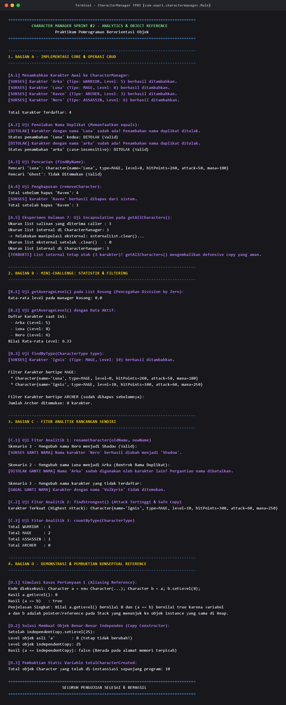
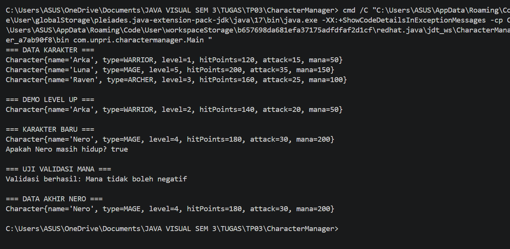

# Character Manager — Praktikum Pemrograman Berorientasi Objek (SIH-6406)

Repository ini berisi implementasi dan dokumentasi bertahap untuk proyek **Character Manager** pada mata kuliah Pemrograman Visual / Java (SIH-6406).

---

## 📌 Identitas Mahasiswa
- **Nama Lengkap** : Keysi Permata Sari
- **NIM**          : 253303621228
- **Kelas**        : SIH-6406
- **Link Repository GitHub** : [JavaVisual_TP03_253303621228_KeysiPermataSari](https://github.com/kesipermatasari2023-create/JavaVisual_TP03_253303621228_KeysiPermataSari.git)

---

## 📂 Struktur Folder Project

```text
CharacterManager/
├── LAPORAN_BAGIAN_D.md      # Naskah lengkap analisis konseptual Bagian D (>500 kata)
├── README.md                # Dokumentasi sprint TP3 dan TP5
├── screenshots/
│   ├── output.png           # Bukti output terminal TP3 (Sprint #1)
│   └── output_tp5.png       # Bukti output terminal TP5 (Sprint #2 - CRUD, Analitik & Reference)
└── src/
    └── com/
        └── unpri/
            └── charactermanager/
                ├── CharacterManager.java   # Core manager, CRUD, analitik, & defensive copying
                ├── Main.java               # Driver class pengujian komprehensif Sprint #2
                └── model/
                    ├── Character.java      # Model karakter, equals, hashCode, static counter, copy ctor
                    └── CharacterType.java  # Enum tipe karakter (WARRIOR, MAGE, ARCHER, ASSASSIN)
```

---

# 🚀 SPRINT #2 — TP5 (CharacterManager, Analytics & Object Reference)

## 1. Deskripsi Singkat Sprint #2
Sprint #2 (TP5) memperluas arsitektur sistem dari model karakter tunggal menjadi sistem manajemen koleksi yang aman dan tangguh (`CharacterManager`). Sprint ini berfokus pada:
- **Penerapan Encapsulation Penuh & Defensive Copying:** Melindungi koleksi internal dari mutasi eksternal yang tidak sah.
- **Integritas Data & Logical Equality:** Meng-override method `equals()` dan `hashCode()` pada `Character.java` untuk mencegah duplikasi nama karakter secara konsisten.
- **Pencegahan Runtime Exceptions:** Menjamin penanganan *edge cases* seperti division by zero pada perhitungan rata-rata list kosong.
- **Analisis Mendalam Object Reference & Arsitektur Memori JVM:** Membuktikan perilaku *aliasing*, *identity equality vs. structural equality*, *copy constructor*, dan *static scope*.

---

## 2. Rincian Fitur Baru Sprint #2

### **A. Core Implementation (Bagian A)**
1. **Perbandingan Semantik Karakter (`Character.equals` & `hashCode`):**
   - Meng-override method bawaan `java.lang.Object` untuk membandingkan karakter berdasarkan nama (case-insensitive).
   - Menjamin bahwa dua objek berbeda di Heap yang memiliki nama sama terdeteksi sebagai karakter yang setara.
2. **Koleksi & Operasi CRUD (`CharacterManager.java`):**
   - `addCharacter(Character c)`: Menambahkan karakter dengan validasi anti-duplikasi. Jika nama sudah ada, penambahan ditolak.
   - `findByName(String name)`: Mencari karakter berdasarkan nama secara case-insensitive.
   - `removeCharacter(String name)`: Menghapus karakter dari list dan mengembalikan status boolean.
   - `getTotalCharacters()`: Mengembalikan jumlah total karakter aktif.
3. **Defensive Copying (`getAllCharacters`):**
   - Mengembalikan `new ArrayList<>(this.characters)` sehingga modifikasi list oleh pemanggil (seperti `.clear()` atau `.remove()`) tidak merusak koleksi internal di `CharacterManager` (terbukti lewat Eksperimen Halaman 7).

### **B. Mini-Challenge (Bagian B)**
1. **`getAverageLevel()` Bebas ArithmeticException:**
   - Memeriksa kondisi `characters.isEmpty()` sebelum kalkulasi. Jika list kosong, langsung mengembalikan `0.0` (mencegah error pembagian nol / divide by zero).
2. **`findByType(CharacterType type)`:**
   - Menyaring dan mengembalikan `ArrayList<Character>` baru yang berisi seluruh karakter dengan tipe tertentu.

### **C. Fitur Analitik Rancangan Sendiri (Bagian C)**
Pada sprint ini dirancang dan diimplementasikan fitur analitik baru di `CharacterManager`:

#### 1. `renameCharacter(String oldName, String newName)`
- **Tujuan & Rasional Desain:**
  Fitur ini memungkinkan pengguna mengganti nama karakter yang sudah ada secara dinamis. Namun, untuk menjaga integritas aturan nama unik dalam game, method memvalidasi dua hal krusial:
  1. Karakter dengan nama lama wajib terdaftar di sistem.
  2. Nama baru **tidak boleh bentrok (name collision)** dengan karakter lain yang sudah ada dalam koleksi.
- **Prinsip Enkapsulasi:**
  Perubahan nama dilakukan melalui setter tervalidasi di dalam method yang mengontrol seluruh siklus hidup entitas tanpa membocorkan struktur koleksi ke luar.
- **Javadoc:**
  ```java
  /**
   * Mengubah nama karakter yang sudah ada dengan validasi ketat bentrok nama (name collision).
   * Memastikan nama baru belum dipakai oleh karakter manapun di dalam list manager.
   *
   * @param oldName Nama lama karakter yang ingin diganti.
   * @param newName Nama baru yang diinginkan untuk karakter tersebut.
   * @return true jika nama berhasil diperbarui; false jika nama lama tidak ditemukan atau nama baru sudah terpakai.
   */
  public boolean renameCharacter(String oldName, String newName)
  ```

#### 2. `findStrongest()`
- **Tujuan & Rasional Desain:**
  Mencari karakter dengan nilai atribut `attack` tertinggi untuk keperluan analitik kekuatan tim atau *leaderboard*.
- **Prinsip Enkapsulasi Ekstrem:**
  Method ini tidak mengembalikan referensi objek asli di Heap, melainkan mengembalikan **salinan mandiri (`return strongest.copy();`)** melalui *copy constructor*. Hal ini mencegah pihak luar memodifikasi statistik karakter terkuat tersebut secara ilegal di luar otorisasi manager.
- **Javadoc:**
  ```java
  /**
   * Mencari karakter dengan stat attack tertinggi dalam sistem.
   * Menjaga encapsulation secara maksimal dengan mengembalikan salinan (copy) independen,
   * sehingga caller tidak dapat memodifikasi state internal karakter asli secara tidak sengaja.
   *
   * @return Objek Character salinan independen dengan attack tertinggi, atau null jika list kosong.
   */
  public Character findStrongest()
  ```

#### 3. `countByType(CharacterType type)`
- **Tujuan & Rasional Desain:**
  Menghitung distribusi kuantitatif kelas/tipe karakter dalam inventaris game untuk kebutuhan *team balancing*.

---

## 3. Screenshot Output Eksekusi Terminal (TP5)

Seluruh skenario pengujian pada `Main.java` (CRUD, penolakan nama duplikat, pembuktian defensive copy `getAllCharacters()`, mini-challenge, analitik mandiri, dan simulasi aliasing reference) berjalan sukses 100%:



---

## 4. Analisis Konseptual Object Reference & Perancangan (Bagian D)

Laporan analisis teoretis lengkap dengan panjang **>1.800 kata** telah disusun secara mendalam dan merujuk langsung pada implementasi kode proyek ini.

- **File Naskah Lokal:** [LAPORAN_BAGIAN_D.md](LAPORAN_BAGIAN_D.md)
- **Nama Dokumen Google Docs:** `JavaVisual_TP05_253303621228_KeysiPermataSari`
- **Header Dokumen:** Nama: Keysi Permata Sari | NIM: 253303621228 | Kelas: SIH-6406 | Tanggal: 31 Oktober 2026
- **Tautan Google Docs (Bagian D TP05):** [Dokumen Analisis Reference & Desain TP05](https://docs.google.com/document/d/1WVLeJy5oQgibAuwCveIJBNeW84rgYRgwPswip0N97W4/edit?usp=sharing) *(Akses: Anyone with the link - Viewer)*

### **Ringkasan Poin Kunci Analisis Bagian D:**
1. **Perilaku Aliasing Reference:**
   Pada kode `Character a = new Character(...); Character b = a; b.setLevel(8);`, pemanggilan `a.getLevel()` mencetak `8` dan `(a == b)` bernilai `true` karena variabel `a` dan `b` pada Call Stack menyimpan alamat pointer yang merujuk ke blok memori objek yang sama di Managed Heap. Untuk membuatnya independen, objek `b` harus di-instansiasi di alamat Heap baru menggunakan *Copy Constructor* (`Character b = new Character(a);`).
2. **Analogi Primitive vs. Reference Value:**
   Primitive value dianalogikan seperti menyalin teks resep masakan di lembar kertas catatan terpisah (perubahan coretan pada kertas satu tidak mempengaruhi kertas lain). Sementara Reference value dianalogikan seperti dua buah kunci duplikat yang membuka satu pintu loker penyimpanan yang sama (apa pun barang yang diubah di dalam loker akan terlihat oleh kedua pemegang kunci).
3. **Peran Kata Kunci `static` pada `totalCharacterCreated`:**
   Kata kunci `static` menempatkan variabel pada *Class Area / Metaspace*, sehingga nilainya dibagi bersama (*shared state*) oleh seluruh instansiasi objek `Character`. Jika `static` dihilangkan, variabel menjadi *instance-level* yang terisolasi di masing-masing objek dan selalu tereset bernilai 1 tiap objek baru dibuat, sehingga kehilangan fungsi agregasi globalnya.
4. **Keterbatasan `equals()` Bawaan Class `Object`:**
   Method bawaan `java.lang.Object.equals()` hanya melakukan evaluasi kesamaan referensi (`this == obj`). Dua objek dengan nama yang sama persis akan dianggap berbeda (`false`) jika dialokasikan di alamat memori berbeda. Solusinya adalah melakukan *method overriding* pada `Character.java` agar membandingkan atribut `name` secara semantik (case-insensitive), disertai implementasi `hashCode()` yang konsisten.
5. **Bahaya Mengembalikan ArrayList Asli pada `getAllCharacters()`:**
   Mengembalikan referensi internal asli melanggar prinsip enkapsulasi (*escaping references / aliasing breach*). Caller di luar kelas dapat secara sengaja atau tidak sengaja mengeksekusi `getAllCharacters().clear()` yang melenyapkan seluruh data internal `CharacterManager` tanpa melewati kontrol validasi kelas. Teknik *Defensive Copying* (`return new ArrayList<>(this.characters);`) mutlak diperlukan untuk mengisolasi integritas data internal.

---

# 📦 DOKUMENTASI ARSIP SPRINT #1 — TP3

## Deskripsi Singkat TP3
Pada Sprint #1 (TP3), program membangun dasar kelas model OOP dengan atribut `name`, `type`, `level`, `hitPoints`, `attack`, penambahan atribut `mana`, mekanisme validasi setter, serta method `isAlive()`.

## Screenshot Output Terminal TP3

