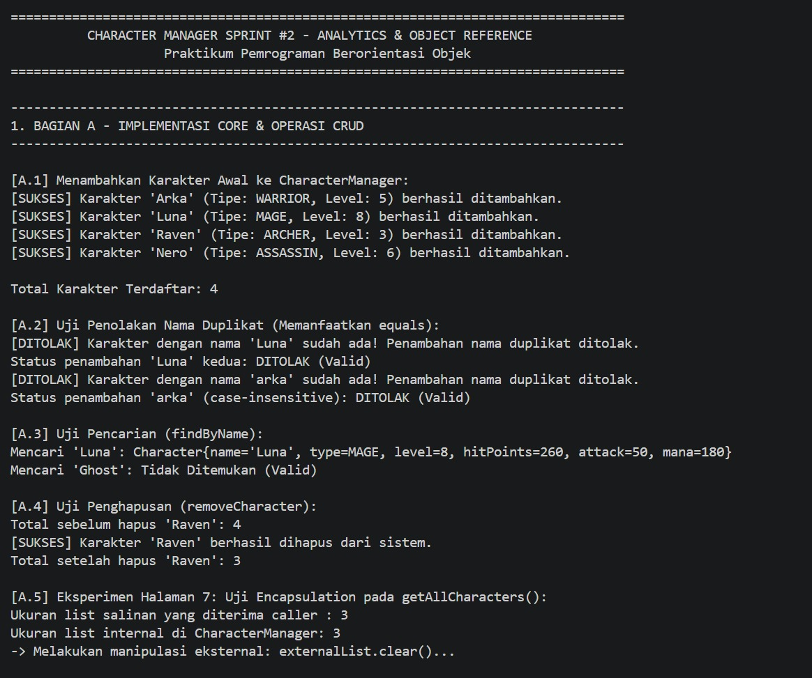
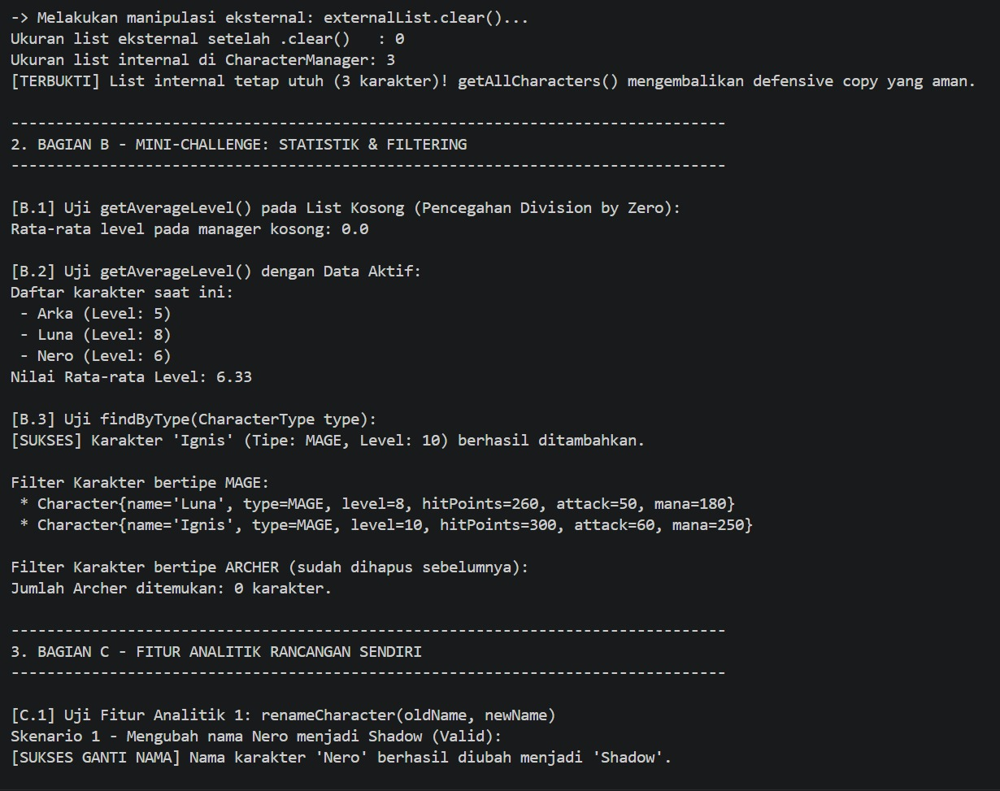
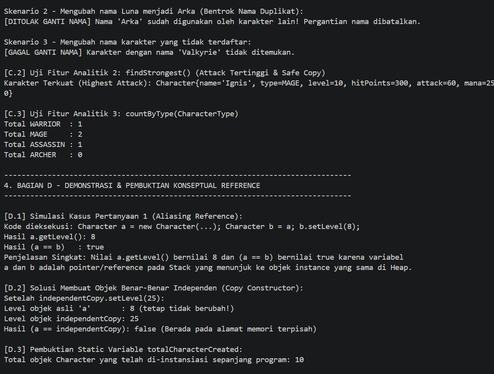
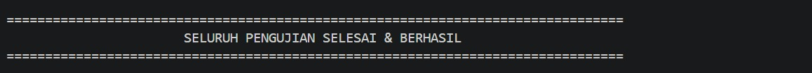
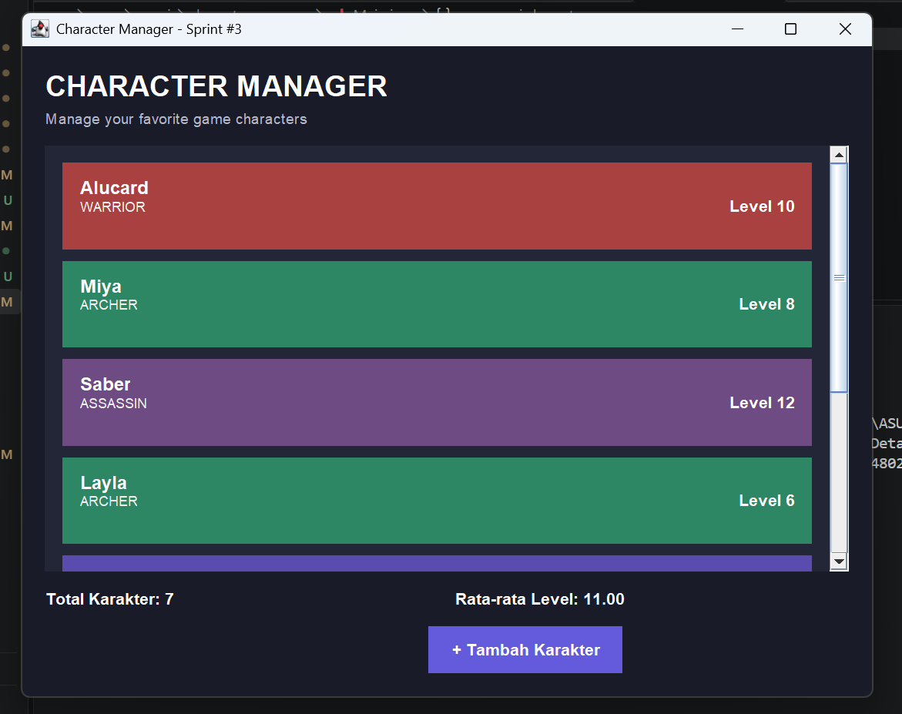

# ANALISIS OBJECT REFERENCE, STATIC, DAN ENCAPSULATION TP5

### IDENTITAS MAHASISWA
**Nama:** Keysi Permata Sari
**NIM:** 253303621228

---

## Object Reference dan Aliasing

Perhatikan kode berikut:

```java
Character a = new Character("KsatriaA", CharacterType.WARRIOR, 1);
Character b = a;
b.setLevel(8);
```

**Hasil:**
- `a.getLevel()` menghasilkan **8**.
- `a == b` menghasilkan **true**.

**Penjelasan:**

`b = a` menyalin reference, bukan membuat objek baru. Kedua variabel menunjuk objek yang sama di Heap. Kondisi ini disebut **Object Aliasing**.

Agar objek independen, gunakan copy constructor:

```java
Character b = new Character(a);
b.setLevel(8);
```

Dengan demikian, perubahan pada `b` tidak memengaruhi `a` dan `a == b` bernilai `false`.

---

## Primitive Value dan Reference Value

- **Primitive Value:** Assignment menyalin nilai secara langsung. Perubahan variabel salinan tidak memengaruhi variabel asal.
- **Reference Value:** Assignment menyalin nilai referensi sehingga dua variabel dapat menunjuk objek yang sama.

**Analogi:** Primitive seperti menyalin catatan ke kertas baru, sedangkan reference seperti dua kunci yang membuka loker yang sama.

---

## Penggunaan Static

Variabel `totalCharacterCreated` harus menggunakan `static` karena berfungsi menghitung seluruh objek `Character` yang dibuat.

```java
private static int totalCharacterCreated = 0;
```

Dengan `static`, semua objek menggunakan satu penghitung bersama. Jika tidak menggunakan `static`, setiap objek memiliki penghitung sendiri sehingga jumlah total karakter tidak dapat dihitung dengan benar.

---

## equals() dan hashCode()

Method bawaan `Object.equals()` membandingkan identitas reference, bukan isi objek. Akibatnya, dua objek berbeda dengan nama sama dianggap tidak sama.

Solusinya adalah melakukan override `equals()` dan `hashCode()`:

```java
@Override
public boolean equals(Object o) {
    if (this == o) return true;
    if (o == null || getClass() != o.getClass()) return false;

    Character character = (Character) o;
    return name != null && name.equalsIgnoreCase(character.name);
}

@Override
public int hashCode() {
    return name != null ? name.toLowerCase().hashCode() : 0;
}
```

Dengan implementasi tersebut, karakter dengan nama sama dianggap setara tanpa membedakan huruf besar dan kecil.

---

## Enkapsulasi dan Defensive Copying

Mengembalikan `ArrayList` asli dapat menyebabkan data internal `CharacterManager` diubah langsung oleh pihak luar.

Contohnya:
- Menambahkan karakter duplikat.
- Memasukkan nilai `null`.
- Menghapus seluruh data karakter.

Solusinya menggunakan **Defensive Copying**:

```java
public ArrayList<Character> getAllCharacters() {
    return new ArrayList<>(this.characters);
}
```

Dengan demikian, pemanggil mendapatkan list baru sehingga perubahan pada list tersebut tidak memengaruhi list internal `CharacterManager`.

## Screenshot Output CRUD





## Google Docs
Link Google Docs: "<https://docs.google.com/document/d/1rGlaiYQTcKmhFxSZHE_rc9npC0_kj8XpU547rbVT4JY/edit?usp=sharing>"

**Keysi Permata Sari | 253303621228**

# Character Manager – TP8 / AP10

## Deskripsi
Character Manager merupakan aplikasi berbasis Java Swing untuk mengelola data karakter game. Aplikasi ini menampilkan daftar karakter, tipe karakter, level, jumlah karakter, dan rata-rata level secara dinamis.

## Teknologi
- Java JDK 21
- Java Swing
- JFrame, JPanel, JLabel, JButton
- ArrayList
- Konsep Object-Oriented Programming (OOP)
- Model-View-Controller (MVC)

## Daftar Karakter

| Nama | Level | Tipe |
|---|---:|---|
| Alucard | 10 | WARRIOR |
| Miya | 8 | ARCHER |
| Saber | 12 | ASSASSIN |
| Layla | 6 | ARCHER |
| Gusion | 14 | MAGE |
| Fanny | 16 | ASSASSIN |
| Tigreal | 11 | WARRIOR |

Dua karakter tambahan:
1. Fanny – ASSASSIN, Level 16. Dipilih karena memiliki level tinggi dan menambah variasi karakter bertipe ASSASSIN.
2. Tigreal – WARRIOR, Level 11. Dipilih karena merupakan karakter bertipe WARRIOR dengan level menengah.

## Statistik
- Jumlah karakter awal: 7
- Total level: 77
- Rata-rata level: 11.00

Setelah tombol Tambah Karakter ditekan:
- Jumlah karakter: 8
- Total level: 86
- Rata-rata level: 10.75

## Alur Data dan MVC

Program dimulai dari Main.java yang membuat objek CharacterManager dan memasukkan data karakter ke dalamnya. Selanjutnya, Main.java memanggil MainWindow untuk menampilkan antarmuka menggunakan Java Swing. MainWindow mengambil data karakter dari CharacterManager melalui method getAllCharacters(), kemudian menampilkannya menggunakan perulangan. Ketika pengguna menekan tombol tambah karakter, data dikirim kembali ke CharacterManager dan tampilan diperbarui melalui refreshDisplay(). Proses ini menunjukkan pemisahan antara Model yang mengelola data, View yang menampilkan antarmuka, dan Controller yang mengatur alur interaksi aplikasi.

## Fitur
1. Menampilkan daftar karakter secara dinamis.
2. Menampilkan level dan tipe setiap karakter.
3. Menghitung jumlah karakter.
4. Menghitung rata-rata level karakter.
5. Menambahkan karakter baru melalui tombol.
6. Memperbarui statistik secara otomatis.
7. Memberikan warna berbeda berdasarkan tipe karakter.

## Screenshot


## Google Docs – Bagian D
Link analisis GUI dan MVC:
[https://docs.google.com/document/d/1_GtfvAoyNY858vT93FwIZh9hws2aPYaj6LWQ9VVL6CI/edit?usp=sharing]


# TP10 – Character Manager Sprint #4

## A. Implementasi AppTheme

Pada Sprint #4, aplikasi Character Manager menggunakan class AppTheme sebagai pusat pengaturan tampilan. AppTheme menyimpan warna, font, dan border yang digunakan oleh MainWindow.

Fitur tema:
- Background aplikasi menggunakan warna gelap.
- Setiap role memiliki warna kartu berbeda.
- Karakter dengan level minimal 5 mendapatkan teks emas dan tebal.
- Font menggunakan logical font SansSerif.
- Border kartu menyesuaikan role karakter.

## B. Mini-Challenge dan Properti Tambahan

Batas level tinggi disimpan dalam konstanta HIGH_LEVEL_THRESHOLD dengan nilai 5.

Karakter dengan level >= 5 ditampilkan menggunakan warna emas dan font tebal.

Dua properti tambahan yang diterapkan:

1. **Tooltip:** Menampilkan informasi nama, level, dan role karakter ketika pointer mouse diarahkan ke kartu. Properti ini membantu pengguna mengetahui informasi karakter tanpa memenuhi tampilan utama.
2. **Border berdasarkan role:** Setiap kartu memiliki border dengan warna yang mengikuti role karakter. Hal ini mempermudah pengguna membedakan karakter secara visual.

## C. Data Karakter

| Nama | Level | Role |
|---|---:|---|
| Alucard | 10 | WARRIOR |
| Miya | 8 | ARCHER |
| Saber | 12 | ASSASSIN |
| Layla | 3 | ARCHER |
| Gusion | 14 | MAGE |
| Fanny | 16 | ASSASSIN |
| Tigreal | 4 | WARRIOR |

Total karakter: 7

Total level: 67

Rata-rata level: 9.57

## D. Mengapa Warna Disimpan di AppTheme?

Warna disimpan di AppTheme karena pengaturan tampilan merupakan tanggung jawab View. Character sebagai Model hanya menyimpan informasi karakter seperti nama, level, dan role. Dengan memisahkan tema dari Model, perubahan tampilan dapat dilakukan tanpa mengubah struktur data karakter.

Pemisahan tersebut juga membuat program lebih mudah dikembangkan dan dipelihara. Jika warna role ingin diubah, programmer cukup mengubah AppTheme tanpa mengubah Character.java atau CharacterManager.java.

## E. Screenshot

### Sebelum (Sprint #3 / v0.3)


### Sesudah (Sprint #4 / v0.4)


## F. Analisis Google Docs

Link Google Docs Bagian D:
[https://docs.google.com/document/d/12tHNQeVO46vodmkLwqnWLq-aCcTH9I9hE5iqt1VPI5Y/edit?usp=sharing]

## G. Teknologi
- Java JDK 21
- Java Swing
- JFrame
- JPanel
- JLabel
- JButton
- ArrayList
- AppTheme
- Model-View-Controller (MVC)
